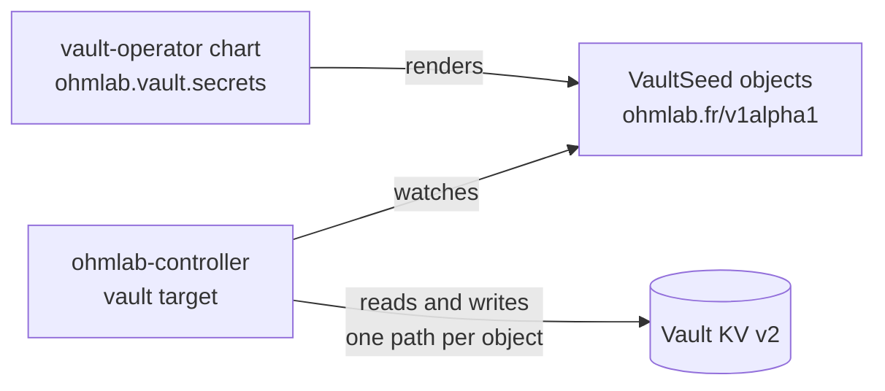

# The ohmlab controller

The controller keeps the platform's backends configured from Kubernetes objects. It runs continuously, so a value that was deleted or edited by hand is corrected without waiting for a sync, and every object reports its own status. Today it configures Vault, gives apps the buckets they claim in a RustFS store, and restarts the workloads that read their certificate only when they start; Harbor and SonarQube follow.

It does not deploy anything. Argo CD does that, starting from the `ohmlab` bootstrap chart ([03-installation.md](03-installation.md)). The controller is one of the apps the instance's `core.yaml` lists, and the objects it reads are rendered by the charts that own the configuration, for example `vault-operator`.



## Enabling it

1. The `ohmlab-controller` chart ships with every target off. Enable the Vault target and name the objects' namespace in the instance values (`argo-cd/instances/<instance>/values/core/ohmlab-controller.yaml`), and list the app in `core.yaml` with a sync wave after `vault-operator`: the controller's Roles go in the namespace `vault-operator` creates, and it logs in with the role `vault-operator` grants. `vault-operator` renders the objects once the controller's CRD exists, at Argo CD's next reconciliation.
2. In the `vault-operator` instance values, set `ohmlab.controller.enabled: true`. The chart then grants the controller its Vault policy and Kubernetes-auth role.
3. Set `ohmlab.vault.seeds.enabled: true` to render one `VaultSeed` per entry of `ohmlab.vault.secrets`.

An instance can run the target with `observeOnly: true` first: the whole reconcile happens and nothing is written. Each object's `Drifted` condition and the `ohmlab_planned_changes` metric say what a real run would do.

## VaultSeed

One object is one KV v2 path.

```yaml
apiVersion: ohmlab.fr/v1alpha1
kind: VaultSeed
metadata:
  name: production-core-keycloak
  namespace: vault-operator-system
spec:
  path: ohmlab/platforms/production/core/keycloak   # <mount>/<path>: the core tier's secrets are in the system mount
  data:
    admin:
      username: admin
      password: "<random:24>"
      passwordHashed: "<bcrypt:admin.password>"
    clients:
      grafana-core:
        clientSecret: "<random:32>"
    webhook: ""                                       # filled in by hand
  rotate:                                             # optional
    token: "2026-10-12"
    keys: [admin.password]
  prune: false                                        # default
  deletionPolicy: Retain                              # default
```

| Field | Meaning |
| --- | --- |
| `path` | `<mount>/<path>` of the secret. Immutable: delete the object and create another. |
| `data` | The tree the path must hold. Leaves are plain values or templates. A key name must not contain a dot. |
| `rotate.token`, `rotate.keys` | Regenerate generated keys once per distinct token. No `keys` means every generated key. |
| `prune` | Remove the keys this controller wrote that `data` no longer declares. |
| `deletionPolicy` | `Retain` leaves the path in Vault when the object is deleted; `Delete` removes it (see [Deletion](#deletion)). |

### Templates

| Template | Value |
| --- | --- |
| `<random:N>` | Random alphanumeric string of N characters (1 to 4096). |
| `<hex:N>` | Random lowercase hex string of N characters (N even). |
| `<uuid>` | Random UUID v4. |
| `<age:secret>`, `<age:public>` | An age X25519 key pair. Within one path the two always belong together. |
| `<bcrypt:key.path>` | The bcrypt hash of another key of the same path. |
| `<ref:mount/path#key.path>` | A copy of a key of another path. |

### What the controller does with a path

- **Seed once.** A key that exists is never overwritten, whether a template made it or a person typed it. A key that is missing is generated. A placeholder declared as `""` stays what a person put there. Changing a template (for example a longer `<random:N>`) does not touch the existing value; rotate it instead.
- **References follow their source.** A key declared as `<ref:...>` is a copy, so it is kept equal to its source at every resync. A reference whose source is missing or empty waits (`RefPending`) and the object writes nothing until every missing key can be computed. A bcrypt hash is rewritten only when it stops matching the key it hashes, so a resync never produces a new salt.
- **Compare and set.** Every write names the KV version it read. If somebody wrote in between, the controller reads again and plans again, so an edit made at that moment is kept.
- **Adoption.** A path created before the object existed (by an earlier version of the chart, or by hand) is adopted: the controller records its owner in the path's custom metadata and leaves the data alone. A path whose owner marker names another object is not touched (`OwnedByAnother`).
- **Rotation.** `rotate.token` is compared with the one recorded on the path. When they differ, the listed keys (or every generated key) are regenerated once and the token is recorded. Leaving the token in place does nothing on later resyncs. The token is recorded after the keys are written: if Vault refuses to record it, the next attempt regenerates the keys again (one more KV version) until it is recorded, and the object reports `Forbidden`.
- **Pruning.** With `prune: true`, keys the controller wrote and the object no longer declares are removed. `status.managedKeys` lists those keys by name; keys written by anybody else are never removed, and an object that lost its status prunes nothing.
- **Quiet resyncs.** An object is reconciled again every ten minutes. A resync that finds nothing to do writes nothing to Vault and nothing to the Kubernetes API.

### Deletion

Deleting an object never blocks by default and never touches Vault. With `deletionPolicy: Delete` the object carries a finalizer and removes its path when it is deleted, provided the path carries this object's owner marker. That needs two switches, because it is destructive: `targets.vault.allowDelete: true` in the controller's chart, and `ohmlab.controller.allowDelete: true` in `vault-operator` (which adds `delete` on the metadata path to the controller's Vault policy). Without the first, an object asking for `Delete` reports `Stalled` with reason `Forbidden` and no finalizer is added.

### Conditions

| Condition | Meaning |
| --- | --- |
| `Ready` | `True` when the path holds what is declared. |
| `Reconciling` | `True` while the object waits for something and retries with backoff (5s doubling to 5m). |
| `Stalled` | `True` when the controller cannot go on as declared. It is checked again at every resync, never with a backoff: a cycle ends when the other object is fixed, and a hash of a value that is still empty ends when the value is filled in. |
| `Drifted` | `True` in observe-only mode when a real run would change something. Its message sums the changes by action and names the keys behind them, for example `1 adopt, 1 update-field (keycloak.clientSecret)`; values never appear. |

| Reason | Condition | What to do |
| --- | --- | --- |
| `Reconciled` | `Ready` | Nothing. |
| `RefPending` | `Ready=False`, `Reconciling` | A `<ref:>` source is missing or empty. Create it, or fix the reference. |
| `RefCycle` | `Stalled` | Objects reference each other. The message lists the paths. |
| `InvalidSpec`, `InvalidRotation` | `Stalled` | The message names the key and the problem. `ohmlab validate` finds them before merge. |
| `OwnedByAnother` | `Ready=False` | Another object owns the path. Delete one of the two, or remove the owner marker by hand to hand the path over. |
| `Forbidden` | `Ready=False` or `Stalled` | Vault refused: its login role is missing or does not accept the controller's ServiceAccount (the message carries Vault's reason), the policy of the role does not cover the path, or a `Delete` was asked without being allowed. |
| `BackendUnavailable` | `Ready=False`, `Reconciling` | Vault does not answer: sealed, restarting or unreachable. |
| `ObserveOnly` | `Ready=False`, `Drifted` | Observe-only mode would change the path. |

Events are emitted when an object enters a failing state and when the controller writes, adopts, rotates or deletes. They name keys and counts, never values.

## Certificate restarts

Some servers read their certificate only when they start (Gitea and oauth2-proxy among the catalog's apps). After cert-manager renews their Certificate they keep serving the old one, which then expires. The `certificates` target rolls them when that happens. Enable it and list each Certificate with the workloads that mount it, in the instance values of `ohmlab-controller`:

```yaml
targets:
  certificates:
    enabled: true
    restarts:
    - namespace: gitea
      certificate: gitea-tls
      workloads:
      - {kind: Deployment, name: gitea}
```

The controller watches the listed Certificates. Each time one is issued again, cert-manager increments its `status.revision`, and the controller sets the pod-template annotation `ohmlab.fr/certificate-revision` of each of its workloads to that revision with a server-side apply. The change rolls the workload the way `kubectl rollout restart` does, and the new pods mount the renewed Secret.

- **First sight.** A workload that does not carry the current revision yet is rolled, including when the target first starts: the controller cannot know which certificate the running pods loaded. Enabling the target therefore restarts each listed workload once.
- **Drift.** The controller owns that one annotation (field manager `ohmlab-controller-certificates`) and nothing else. Argo CD's server-side and client-side apply keep it, as they keep the annotation `kubectl rollout restart` writes. A `Replace=true` sync or a hand edit that removes or changes it costs two rollouts: that change itself, then the controller putting the annotation back at the next resync.
- **Shape.** A workload is a `Deployment`, `StatefulSet` or `DaemonSet` in its Certificate's namespace (a Secret mounts nowhere else), listed under one Certificate only. A workload whose update strategy is `OnDelete` gets the annotation but replaces its pods only when they are deleted; the controller says so with a Warning event.
- **What it may touch.** The chart renders the RBAC from the same list: the target reads Certificates in the listed namespaces, and gets and patches each listed workload by name. It cannot list workloads or read Secrets. RBAC cannot limit a patch to one field, and a patch could otherwise mount a Secret, switch the ServiceAccount or replace the image, so the chart adds a `ValidatingAdmissionPolicy`: the API server refuses the target's ServiceAccount any change to a workload but this annotation, comparing the spec, the pod template and the workload's labels, annotations, owners and finalizers field by field.

The target needs cert-manager's `Certificate` CRD (without it the target never starts and its process restarts in a loop) and Kubernetes 1.30 or later for the admission policy, which the instance's `core` AppProject must allow (the `ohmlab` chart's default does).

Each roll is a `Restarted` event on the Certificate and a count in `ohmlab_workload_restarts_total`. A missing workload is a `WorkloadNotFound` event, and the Certificate's `ohmlab_object_ready` stays 0. To try it, ask cert-manager to issue a Certificate again, as `cmctl renew` does:

```sh
kubectl -n gitea patch certificate gitea-tls --subresource=status --type=json -p \
  "[{\"op\":\"add\",\"path\":\"/status/conditions/-\",\"value\":{\"type\":\"Issuing\",\"status\":\"True\",\"reason\":\"ManuallyTriggered\",\"message\":\"manual renewal\",\"lastTransitionTime\":\"$(date -u +%Y-%m-%dT%H:%M:%SZ)\"}}]"
```

## Object storage (S3Bucket)

The `storage` target gives each app the bucket it claims. One `S3Bucket` is one claim: a bucket in a store, with its quota, versioning and lifecycle, an identity confined to it, and the app's key in the claim's Vault record. The app reads its key from the record through a VaultStaticSecret, like any other secret. The instance-manager renders the objects from the catalog's claims and the instance's stores, and wires each app to its claim: see [10-object-storage.md](10-object-storage.md).

```yaml
apiVersion: ohmlab.fr/v1alpha1
kind: S3Bucket
metadata:
  name: ohmlab-keycloak-pg
  namespace: ohmlab-system
spec:
  store: backups                                    # a store of the target's configuration, never an endpoint
  bucket: ohmlab-keycloak-pg                        # <bucketPrefix><mount>-<app>-<claim>; immutable
  credentials:                                      # the claim's record and key; immutable
    path: ohmlab/platforms/production/core/keycloak/s3
    key: pg
  access: readWrite                                 # default; or readOnly
  quota: 2Gi
  versioning: true                                  # default
  lifecycle: {noncurrentDays: 7, expireDays: 0}     # defaults
  rotate: {token: "2026-11-12"}                     # optional
  deletionPolicy: Retain                            # default
```

| Field | Meaning |
| --- | --- |
| `store` | A store of the target's configuration. Where to connect and as whom is the controller's business, never the object's. |
| `bucket` | The store's `bucketPrefix` (empty on RustFS), then the record's mount, app and claim joined by dashes. An object can only name the bucket its record implies. The name leaves the record's env and scope out, and its parts may hold dashes, so two records can imply one bucket: the younger of their objects waits at `OwnedByAnother` and writes nothing. A bucket kept with its data goes to the next claim whose record implies its name. At most 63 characters. |
| `credentials.path`, `credentials.key` | The app's record, `<mount>/platforms/<env>/<scope>/<app>/s3`, and the claim's key in it. |
| `access` | `readWrite` lists, reads, writes and deletes objects; `readOnly` lists and reads. Neither may delete an object version or change the bucket's configuration (versioning, lifecycle, policy, object lock, replication), so an app that is taken over cannot erase its history faster than the lifecycle does. |
| `quota` | The bucket's hard quota: the store refuses the writes beyond it. |
| `lifecycle` | Noncurrent versions expire after `noncurrentDays`, and objects after `expireDays` unless it is 0: a backstop for a producer that stops pruning. |
| `replicate` | Reserved for a cloud replica; nothing acts on it yet. |
| `rotate.token` | Make a new key once per distinct token (see [Rotation](#rotation)). At most 128 characters. |
| `deletionPolicy` | `Retain` or `Delete` (see [Deleting a claim](#deleting-a-claim)). |

### The record

An app has one record, `<mount>/platforms/<env>/<scope>/<app>/s3`, with one key per claim, so the claims of one app share it. A claim's key holds:

| Field | Value |
| --- | --- |
| `accessKey`, `secretKey` | The app's key: 20 characters `[A-Z0-9]` and 40 characters `[A-Za-z0-9]`, generated once. |
| `endpoint`, `region`, `pathStyle` | The store's, from the target's configuration; `pathStyle` is `"true"` or `"false"`. |
| `bucket` | The bucket's name. |
| `ca` | The stores' CA (PEM), read again at every reconcile, so a rotation of the CA reaches the apps. Empty for a store behind a public CA. |

The record's custom metadata says who owns what. `ohmlab.fr/owner: ohmlab-controller-storage` marks the path, so a `VaultSeed` aimed at it stops at `OwnedByAnother`. `ohmlab.fr/claim.<claim>: <namespace>/<name>` marks each key with the `S3Bucket` that owns it: a second object on the same key waits at `OwnedByAnother` and writes nothing. A key that holds a pair and has no marker (written by hand before the object existed) is adopted. A rotation adds `ohmlab.fr/rotation-token.<claim>` and, during its grace, `ohmlab.fr/retiring.<claim>`.

### In the store

On a `rustfs` store, each claim has:

- the bucket, its versioning, a lifecycle rule `ohmlab`, and the hard quota;
- a canned policy `ohmlab-<bucket>-<access>` that allows the bucket's object operations and denies deleting a version and every bucket-configuration action;
- a user named after the bucket, with that policy attached and no other one: a policy attached by hand is detached at the next resync. The user's own secret is random and stored nowhere, so nothing logs in as it;
- the app's key, a service account of that user.

### Vault first, then the store

Every reconcile reads the store, writes the record (its data with compare-and-set; on a path that exists, its custom metadata first) and then makes the store match it. Vault is the source of truth:

- A key is generated into the record before the store knows it, so a crash never leaves the store with a key that Vault does not hold.
- A store rebuilt empty gets every bucket, policy, user and key back at the next resync, with the same keys. The objects in the buckets are not restored: that is the replica's job.
- A service account of the user that the record does not name is removed. Its `Removed` event names its first four characters only.
- A new pair written into the record by hand is followed: its service account is added and the old one removed. A hand edit of `secretKey` alone is not followed, because a service account's secret cannot be read back: change keys with `rotate.token`.

A resync that finds nothing to do writes nothing to Vault, the store or the Kubernetes API.

`targets.storage.observeOnly: true` plans every record and store change and writes none. `Drifted` sums them by action and names what they touch, for example `1 create-bucket (ohmlab-keycloak-pg), 2 add-key (accessKey, secretKey)`. A key never appears.

### Rotation

A new `rotate.token` writes a new pair into the record and keeps the old access key in `ohmlab.fr/retiring.<claim>`, with a deadline. Both keys work until then: VSO's refresh delivers the new one, and a job that started with the old one finishes. The first reconcile after the deadline removes the old service account. The grace is `targets.storage.rotationGrace`, 26 hours by default: VSO's hour plus a day's backup cycle. The deadline lives in the record, so a restart of the controller changes nothing. The marker is written before the new pair, so a rotation that Vault interrupts between the two writes resumes at the next reconcile, with a new deadline. A claim keeps one old key: a second rotation within the grace replaces it, and the first old key goes at the next reconcile.

### Deleting a claim

Deleting an `S3Bucket` with `deletionPolicy: Retain` (the default) leaves the bucket, its identity and the record. With `Delete` and `targets.storage.allowDelete: true`, the object carries a finalizer, and deleting it removes the service accounts, the user and the policy, in that order (RustFS refuses to remove an attached policy), then the bucket if it holds no object version, then the claim's key and markers from the record. A bucket that holds data is never removed. Without `allowDelete`, an object asking for `Delete` reports `Stalled` with reason `Forbidden`.

### Stores, root keys and CA

The target's configuration lists its stores. Each one names where its root keys live in Vault (`rootCredentials`: a path and a key holding `accessKey` and `secretKey`). The target reads them itself, with its own Vault role, at the first reconcile that needs the store, and again after the store refused them. No Kubernetes Secret holds a copy. The stores' CA comes from a ConfigMap (`targets.storage.storeCA`, trust-manager's `ohmlab-internal-ca` bundle by default) that the target reads at every reconcile: it verifies the stores with it and writes it into every record. A store's endpoint is `https://<host>:<port>`.

```yaml
targets:
  storage:
    enabled: true
    observeOnly: false
    allowDelete: false
    rotationGrace: 26h
    stores:                                 # the instance-manager fills it from instance.yaml
    - name: backups
      type: rustfs
      endpoint: https://rustfs-svc.rustfs-backups.svc:9000
      region: eu-west-1                     # the store's own region
      pathStyle: true
      capacity: 50Gi                        # the store's volume
      namespace: rustfs-backups             # where its pods run, for the egress policy
      rootCredentials: {path: ohmlab/platforms/production/core/rustfs-backups, key: admin}
```

The chart refuses a store without a name, type, endpoint, region, namespace, capacity or root keys, an endpoint that is not `https://<host>:<port>`, and unknown keys. The target's Deployment takes `targets.storage.resources` rather than the shared `resources`: each admin call that creates a user or a key, or attaches a policy, encrypts its request with a 64 MiB argon2id key, so the target idles near 40 MiB and peaks near 190 MiB while it writes. The target's Vault policy, which `vault-operator` renders, creates, updates and reads `…/platforms/+/+/+/s3` and reads each store's root keys, and nothing else.

### Metrics and alerts

The target reports through the controller's metrics (`ohmlab_object_ready`; `ohmlab_backend_requests_total` and `ohmlab_backend_writes_total`, whose ops are named after the store calls, such as `create-bucket` and `add-service-account`), and adds `ohmlab_storage_bucket_quota_bytes{store,bucket}` and `ohmlab_storage_capacity_bytes{store}`. With the target on, the chart adds four alerts:

| Alert | Fires when |
| --- | --- |
| `OhmlabStoreFilling` | A store's volume is more than 75% full for 15 minutes (warning). |
| `OhmlabStoreFull` | It is more than 85% full for 5 minutes (critical): a full store refuses every write, the backups in it included. |
| `OhmlabBucketNearQuota` | A bucket is above 80% of its quota for 30 minutes, from RustFS's `rustfs_cluster_usage_buckets_total_bytes`. |
| `OhmlabStorageOvercommitted` | A store's quotas add up to more than 80% of its capacity for 15 minutes. |

## Topologies

The unit is the **target**; a Deployment is only packaging. By default each enabled target gets its own Deployment, ServiceAccount, RBAC, Vault role and network egress (`split`). The chart's `deployments` map groups targets into shared processes, for example `{all: [vault, harbor, sonarqube]}`, or `{vault: [vault], apps: [harbor, sonarqube]}` to keep Vault alone. Every enabled target must appear exactly once. The `storage` target is the exception to grouping: it holds the stores' root keys and always gets a Deployment of its own, for example `{all: [vault, certificates], storage: [storage]}`. A group of `networkPolicy.extraEgress` applies to every pod of the namespace unless it names a `podSelector`: scope a target's egress to its own Deployment with `app.kubernetes.io/component: <deployment>`, or the other targets get it too.

Whatever the grouping, each target runs its own manager: its own cache, work queue and Lease (`ohmlab-controller-<target>`). A rolling update therefore never runs a target twice, and one process serves one metrics and one probe endpoint.

A shared process is not a security boundary. What is isolated and what is not:

| | `split` | one process for several targets |
| --- | --- | --- |
| Memory, OOM limit, failure domain | per target | shared |
| ServiceAccount, RBAC, network egress | per target | shared (the union) |
| Backend credentials in memory | per target | each target holds only its own; the packages cannot import each other (checked in CI) |
| Configuration | each process receives only its targets' sections | same |
| Logs, concurrency, timeouts, panics | per target | per target |
| Probes | the process | the process; a target whose backend is down never fails them |

## Security

- **Objects say what, never where or as whom.** Backend addresses and credentials live in the controller's configuration, so no object can point the controller at another endpoint.
- **Namespaces.** A target reconciles only the namespaces its chart lists. Objects anywhere else are ignored. Only Argo CD and cluster administrators can write in them.
- **Vault.** The Vault target logs in under a role bound to its ServiceAccount, with a projected ServiceAccount token whose audience is `vault` (`targets.vault.backend.auth.audience`) rather than the pod's API token: the JWT Vault receives is not a Kubernetes API credential, and lives ten minutes. The role accepts only that audience (`ohmlab.controller.audience` in `vault-operator`), so no other token of the ServiceAccount logs in. Vault grants a 15-minute token, which the controller replaces before it expires. Its policy covers KV data and metadata under `platforms/+/+/*` of the system mount and of the instance's, and nothing else: no identity, policies, auth methods, mounts or tokens. Deleting needs the extra grant described above.
- **Storage.** The `storage` target holds the stores' root keys, so it runs alone: the chart refuses to group it, and the controller refuses `--target=storage` beside another target. Its Vault role writes the claims' records and reads the stores' root keys, nothing else. It has no access to Kubernetes Secrets: the root keys stay in Vault and in its memory. With the chart's network policy, `allow-storage-egress` lets it reach its stores' pods on their port; the API server, DNS and Vault come from `extraEgress`, scoped to its Deployment like the other targets'. An app's key reaches its own bucket only.
- **Kubernetes.** Roles in the watched namespaces (not ClusterRoles), a Role for its own Leases, and one ClusterRole that reads its own CRDs by name. The `certificates` target has no CRD and no ClusterRole: it reads Certificates in the namespaces it lists, and gets and patches its listed workloads by name. No access to Secrets, and an admission policy keeps its workload patches to the one annotation it sets ([Certificate restarts](#certificate-restarts)).
- **Pod.** Restricted Pod Security (non-root numeric user, read-only root filesystem, no capabilities, `RuntimeDefault` seccomp), a distroless image with no shell, signed with SLSA provenance (Kyverno's `verify-images` policy covers it), a default-deny network policy when the instance turns on the chart's `networkPolicy` (off by default), with the egress to the API server, DNS and Vault written in `extraEgress`.
- **No secret material** in an object's spec (templates only), status, events, logs or metric labels. Status holds key names and KV versions.

## Operating

Metrics, alerts and a dashboard come with the chart. The PodMonitor and the alert rules render only where the Prometheus Operator CRDs exist (`prometheus-stack`), so the app syncs without them and gains them at Argo CD's next reconciliation once they are installed. The alerts: `OhmlabControllerDown`, `OhmlabObjectNotReady`, `OhmlabReconcileStale` (three resyncs without a completed reconcile), `OhmlabBackendErrors`, `OhmlabBackendForbidden`, `OhmlabWriteLoop` (a sustained rate of data writes, which means something else rewrites the path), `OhmlabRestartLoop` (a workload rolled more than twice in an hour), `OhmlabCRDRevisionMismatch`, and with the storage target `OhmlabStoreFilling`, `OhmlabStoreFull`, `OhmlabBucketNearQuota` and `OhmlabStorageOvercommitted` ([Metrics and alerts](#metrics-and-alerts)).

```sh
kubectl get vaultseeds,s3buckets -A             # path or bucket, Ready, reason
kubectl -n vault-operator-system describe vaultseed production-core-keycloak
kubectl -n ohmlab-system describe s3bucket ohmlab-keycloak-pg
```

- **An `S3Bucket` is `OwnedByAnother`.** Another `S3Bucket` holds the record's key (the record's `ohmlab.fr/claim.<claim>` names it) or, through another record, the same bucket (the message names it); or the record belongs to something else, such as a `VaultSeed` whose owner marker is on the path. Delete the duplicate object. To hand a key over, remove its claim marker by hand. Deleting the waiting object removes nothing from the store.
- **An `S3Bucket` is `BackendUnavailable` with `context deadline exceeded`.** The store does not answer. Each store call ends after 15 seconds, its retries included, so a store that is down holds the target only that long per attempt, and the claims of the other stores carry on.
- **An `S3Bucket` is `Stalled` with `InvalidSpec`.** The message says why: a store the target does not know, a quota of zero, or a bucket that is not the one its record implies, with the expected name.
- **An `S3Bucket` is `Forbidden`.** The message says whether Vault refused (the target's role, or a record path its policy does not cover) or the store did (root keys in Vault that the store does not hold, for example after they changed in Vault only). The target reads the root keys again after a refusal, so a fix in Vault is picked up at the next attempt.

- **An object stays `RefPending` after its source exists.** The retry delay grows to five minutes; touch the object (an annotation change does not count, the spec must change) or wait.
- **A deleted object's finalizer will not clear.** Only `deletionPolicy: Delete` adds one. Read the `Forbidden` or `BackendUnavailable` condition. Once the cause is fixed it finishes by itself; to give up on removing the path, patch the finalizer away: `kubectl patch vaultseed <name> -p '{"metadata":{"finalizers":null}}' --type merge`.
- **`OhmlabCRDRevisionMismatch`.** The CRDs come from the catalog and the image from its pin, and they were released apart. Bring the lagging one up to the same release.
- **The `VaultSeed` objects do not appear on a new cluster.** `vault-operator` renders them only once the kind exists, which the `ohmlab-controller` application installs. Argo CD renders `vault-operator` again at its next reconciliation once the CRD is there (within about three minutes with the default `timeout.reconciliation`), with no refresh needed. If they are still missing after that, check that the `ohmlab-controller` application has synced. With progressive sync on (`progressiveSync.enabled` in `instance.yaml`), they appear with the next commit or a manual sync of `vault-operator`: the ApplicationSet controller syncs an app again only when its revision changes.
- **The `vault-operator` sync stays `Running`.** Argo CD waits for every object it applies to be Healthy, and a `VaultSeed` is Healthy once the controller has reconciled it (`Ready`, or `ObserveOnly` in observe-only mode; `Stalled` is Degraded and fails the sync). The objects are the app's last sync wave, so everything else has been applied already: read the waiting object's conditions, and check that the controller runs.
- **`OhmlabRestartLoop`.** Something undoes the workload's `ohmlab.fr/certificate-revision` annotation, or cert-manager issues its Certificate again and again. The workload's `managedFields` name the other writer; the Certificate's events and cert-manager's logs show repeated issuances.
- **A path was changed by hand.** The controller sees it at the next resync, not at once. Keys the objects declare as references are put back, and a declared key that was deleted comes back (with a new value if it is generated). Any other value you changed stays.

## Checking objects before merge

`ohmlab validate` checks objects without a cluster, from files or from a rendered chart:

```sh
helm template vault-operator argo-cd/apps/vault-operator -f argo-cd/instances/<instance>/values/core/vault-operator.yaml \
  --set ohmlab.vault.seeds.enabled=true --set ohmlab.vault.seeds.requireCRD=false | ohmlab validate -
```

It reports malformed templates, bcrypt targets and rotation keys that do not exist, key names with a dot, two objects on one path, repeated names and reference cycles. CI runs it over every instance.

## Not covered yet

Harbor and SonarQube have target names reserved and no objects yet. The storage target manages RustFS stores only: cloud stores, the encrypted cloud replica that `replicate` asks for, and claims of apps on spoke clusters are not there yet. Objects owned by applications in their own namespaces (so an adopter's app can declare its own configuration) are a later addition: the allow-list and the owner markers are what it will build on.

Identity groups and their OIDC aliases are not the controller's either: the `vault-operator` chart renders `ohmlab.vault.identity` into the Vault resource's `externalConfig`, where bank-vaults applies them.
