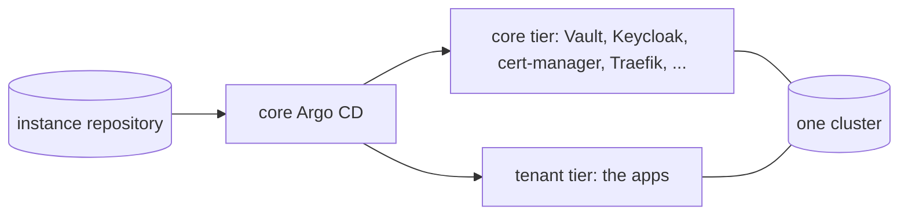

# All-in-one

One instance on one cluster runs both tiers: the shape of [`_example`](../../argo-cd/instances/_example), which documents every field an instance sets, and the default of [the installation guide](../03-installation.md).

- `instance.yaml` names no hub: the instance runs its own Vault (the `vault-operator` app), which both tiers read, the core tier on the system mount `ohmlab` and the tenant tier on the instance's own.
- `destination.server` is the in-cluster API server, which the base projects (`admin-core`, `admin-tenant`) allow.
- One Keycloak serves both tiers: the system realm `ohmlab` holds the core apps' clients and the instance's realm the tenant apps'.
- Each app that fits either tier is enabled in exactly one ([where an app runs](README.md#where-an-app-runs)).

## Values to copy

Copy [`_example`](../../argo-cd/instances/_example) under the instance's name, then follow [the installation guide](../03-installation.md): its bootstrap runs on this one cluster, and the root manager deploys the instance's apps from there.

## Growing past one cluster

The instance can stay the hub when more clusters come: give the new clusters instances of their own that name it in `vault.hub` ([a remote Vault](40-remote-vault.md)), register those clusters with the core Argo CD ([remote clusters](50-remote-clusters.md)), and give each cluster a layer ([shared clusters](60-shared-clusters.md) when several instances share one).
