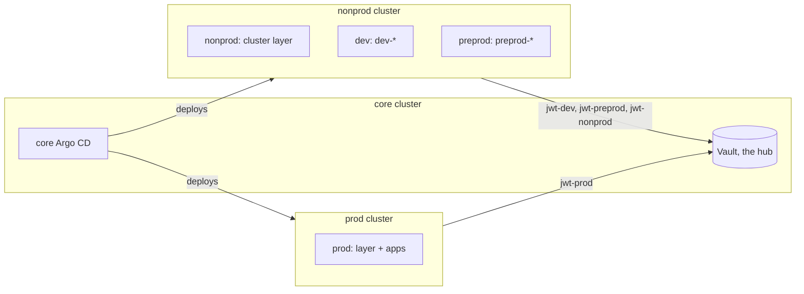

# Platform team

A company's platform team runs a management cluster and its environments on managed clusters: development and pre-production share one, production has its own. The example is [`examples/platform-team`](../../examples/platform-team), whose README lists the placeholders to replace.

| Instance | Cluster | Tiers | Runs |
| --- | --- | --- | --- |
| `platform` | core (in-cluster) | core | the core Argo CD (ohmlab chart, root manager), Vault as the hub, the controller, Keycloak for the admins, cert-manager, trust-manager, Traefik, CloudNativePG, Kyverno, prometheus-stack |
| `nonprod` | nonprod | core | the cluster layer: cert-manager, Traefik (one Gateway for both environments), the Vault Secrets Operator alone, CloudNativePG, Kyverno, Prometheus and Alertmanager |
| `dev` | nonprod | tenant | Keycloak (realm `dev`) and the apps, prefix `dev-` |
| `preprod` | nonprod | tenant | the same, prefix `preprod-` |
| `prod` | prod | core and tenant | the cluster layer, Keycloak (realm `prod`) and the apps |

## What each instance sets

- **`platform`**, the hub: `vault-operator` lists the remote clusters and their instances under `spokeClusters`, and seeds every remote app's secrets on that instance's own mount ([a remote Vault](40-remote-vault.md)). Its `ohmlab` values register the two clusters and give each remote instance and tier a project that allows its cluster and namespaces only ([remote clusters](50-remote-clusters.md)).
- **`nonprod`** owns what the two environments share on their cluster ([shared clusters](60-shared-clusters.md)): one Traefik whose Gateway has a listener per environment's wildcard, and one Kyverno whose built-in exceptions also cover the prefixed namespaces of the tenants' apps.
- **`dev` and `preprod`** each set `vault.hub: platform`, a `namespacePrefix`, and `names.gateway: nonprod-gateway`, the layer's Gateway. Each route names its environment's listener (`listener: https-dev`): a listener serves only the hosts under its own wildcard. Each runs its own Keycloak, whose realm is the instance's: a remote Keycloak imports its own realm alone, without the system realm and its clients.
- **`prod`** holds both tiers, as it is alone on its cluster.

A remote cluster's layer runs the Vault Secrets Operator alone, pointed at the hub's route: three switches in `vault-operator` (`vault-operator.enabled`, `vault.enabled` and `vaultOidcCredentials.enabled`, all false) and `vso.defaultVaultConnection.address`.

## Bootstrap order

1. On every cluster, a DNS-01 issuer for the Gateways' wildcard certificates, and on the core cluster for Argo CD's own. On each managed cluster, the Gateway API CRDs: the bootstrap installs them on the core cluster only.
2. On the core cluster: `./run.sh -b platform -i <instance repository>/argo-cd/instances`. The root manager deploys `platform`, whose Vault and controller create every instance's mounts, roles and seeds.
3. The core Argo CD's access to each remote cluster: a service account there, its token and the cluster's CA in Vault ([remote clusters](50-remote-clusters.md#registering-a-cluster)). The root manager then deploys `nonprod`, `prod` and the tenants. Their apps all sync at once, as sync waves alone order nothing ([installation](../03-installation.md)): an app that syncs before its cluster's layer is up fails, retries three times over about three and a half minutes, then waits for the next commit or a sync by hand.
4. The values seeded empty, by hand: each cluster's Alertmanager webhook.

## Promotion by catalog version

Each instance pins the catalog it takes its charts from (`catalogs.release.version` in `instance.yaml`). A release reaches `dev` first; `preprod` follows once `dev` runs it cleanly, then `prod`. The layers move with their clusters' environments: `nonprod` with `preprod` at the latest, as both environments run on it. CI renders every instance from the change under test, whatever it pins, so a pin moves nothing on its own.

## Adding an environment

To add `qa` on the nonprod cluster:

1. Copy `dev` as `qa`, with the prefix `qa-`, the realm and domains of `qa`, and `listener: https-qa` on its apps' routes.
2. On `platform`: a `qa` entry under the `nonprod` cluster's `spokeClusters` instances, the seeds of its apps on the mount `qa`, and a project `qa-tenant` for the nonprod server and `qa-*`.
3. On `nonprod`: a listener for `*.qa.example.com` (`gateway.extraWildcardListeners` in Traefik's values) and its name on the certificate (`gateway.extraDnsNames`), and `qa-rustfs` in Kyverno's `exceptionNamespaces`.

`check-vault-seeds.sh` names any key the new instance's apps read that the hub does not seed, and `check-shared-clusters.sh` any namespace or object it shares with another instance of the cluster.

## What the shared cluster does not isolate

`dev` and `preprod` are kept apart by their KV mounts, jwt mounts, roles bound to their own namespaces and projects, not by their cluster: they share one trust domain, and an admin of the nonprod cluster can read both. Give an environment its own cluster when that matters.
