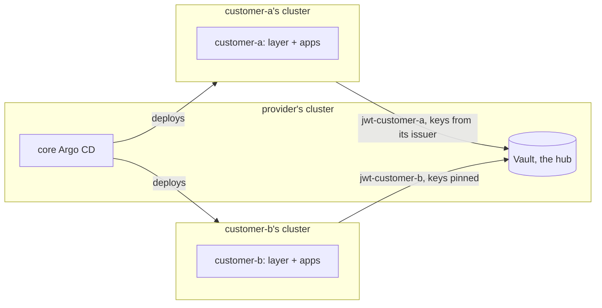

# Service provider

A provider runs the platform for its customers, each on a cluster of its own, from one management cluster. The example is [`examples/service-provider`](../../examples/service-provider), whose README lists the placeholders to replace.

| Instance | Cluster | Tiers | Runs |
| --- | --- | --- | --- |
| `provider` | core (in-cluster) | core | as `platform` in [the platform team's case](20-platform-team.md): the core Argo CD, Vault as the hub, the controller, Keycloak for the provider's admins, the core's own layer |
| `customer-a` | customer-a | core and tenant | the cluster layer, its own Keycloak and the apps; Vault reads the cluster's keys from its issuer |
| `customer-b` | customer-b | core and tenant | the same, with the cluster's keys pinned: a cluster without a public issuer |

Each customer is one instance with both tiers, alone on its cluster, so no layer is shared and no namespace needs a prefix. Each customer's Keycloak serves its own users alone: a remote Keycloak imports its own realm, without the provider's system realm.

## What keeps customers apart

| Between | Kept apart by |
| --- | --- |
| Two customers | their clusters, their clusters' keys, their jwt mounts, their KV mounts, their policies and their Argo CD projects |
| A customer and the provider's own secrets | the system mount `ohmlab` and the provider's own mount appear in no customer's policy |
| A customer and every write | read-only policies: only the controller, on the provider's cluster, writes |

A customer's cluster can present only tokens signed by its own keys, which only its own jwt mount accepts, for roles bound to its own namespaces and policies on its own mount. Its project lets the core Argo CD deploy its Applications to its cluster alone. [A remote Vault](40-remote-vault.md) explains what the hub creates per instance.

## Onboarding a customer

1. Copy a customer folder under the customer's name, with its domains, its cluster's API server and its own Keycloak realm.
2. On `provider`:
   - in `vault-operator`, a `spokeClusters` entry for the customer's cluster, with its issuer (`oidcDiscoveryUrl`) or its public keys (`publicKeys`), and the customer's instance with its apps;
   - the seeds of the customer's apps, on the mount named after it (`check-vault-seeds.sh` names every key missing);
   - in `ohmlab`, a `clusters` entry and a project per tier for the customer's server.
3. The customer's cluster: the Gateway API CRDs, a DNS-01 issuer, and the service account whose token and CA the core Argo CD needs ([remote clusters](50-remote-clusters.md#registering-a-cluster)).
4. The hub's route admits the cluster's outbound addresses: add them to `gateway.sourceRange` in `vault-operator`.

## Offboarding a customer

1. Remove the customer's folder. The root manager drops its instance and Argo CD deletes its Applications, but not what they deployed: no Application carries the resources finalizer, so that deleting one never takes down what it runs. Retire the customer's cluster, or clean it by hand.
2. On `provider`, remove the customer's `clusters` entry and projects in `ohmlab`, its seeds and its `spokeClusters` instance in `vault-operator`, and its outbound addresses from `gateway.sourceRange`.
3. Then in Vault, by hand: the configuration only adds, so the customer's KV mount, jwt mount and policies stay until they are removed ([offboarding](40-remote-vault.md#offboarding-an-instance)), and its seeded data stays with them, as a seed retains its path by default.
