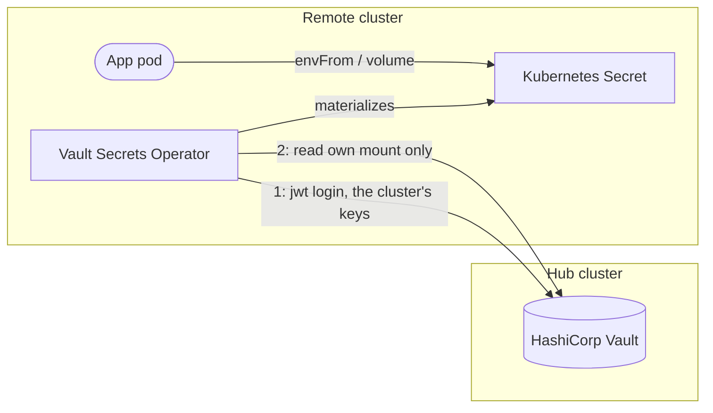

# A remote Vault

An instance on another cluster than its Vault reads the Vault of a **hub**, another instance of the same repository, which runs the only Vault and the only controller of the topology. Nothing changes until an instance sets `vault.hub` in its `instance.yaml` and the hub declares it under `vault.externalConfig.spokeClusters` in its `vault-operator` values, where [the shape is documented](../../argo-cd/apps/vault-operator/values.yaml).



The hub cannot use the `kubernetes` auth method for another cluster: that method validates a token by calling TokenReview on the cluster that issued it, so the hub would need a route into every remote API server, the direction that does not survive NAT, firewalls or a cluster that comes and goes. The `jwt` method validates the token's signature with the cluster's keys instead, and calls nothing but, at most, the cluster's issuer over HTTPS. Isolation between clusters is cryptographic: a token signed by other keys is refused.

## What the hub creates per instance

`spokeClusters` lists each remote cluster, its keys, and the instances it runs with their apps:

```yaml
# The hub's vault-operator values.
vault:
  externalConfig:
    spokeClusters:
    - name: nonprod
      oidcDiscoveryUrl: https://oidc.nonprod.example.com
      instances:
      - name: dev
        namespacePrefix: dev-
        apps: [gitea, {name: keycloak, namespace: dev-keycloak}]
```

For each instance, the hub's Vault gets:

- **a KV mount**, the instance's name by default (`mount` sets another): both of the instance's tiers keep their secrets there, under `platforms/<instance.env>/<tier>/<app>`;
- **a jwt mount**, `jwt-<instance>`, with the cluster's keys;
- **per app, a role** named after the app, bound to the app's service account and namespace (`bound_subject` and the namespace claim), with the cluster's audience (`vault` by default) and a one-hour token;
- **per app, a policy** `<instance>-<app>`: the hub's own policy of the app, rewritten onto the instance's mount, read and list only.

An app's namespace is the entry's `namespacePrefix`, the one namespace the hub's kubernetes role of the app binds, then its `namespaceSuffix`, as the instance's own manager derives it: keep the prefixes of both sides equal, and set `namespace` on an app the instance deploys elsewhere. `check-vault-access.sh` compares them. The render fails rather than hand a cluster more: a policy that would write or leave the mount, two instances binding one namespace, a mount that overlaps another, a reserved name.

On the remote side, the instance's manager gives every app the jwt method and the instance's mount, and the cluster's layer runs the Vault Secrets Operator alone: `vault-operator.enabled`, `vault.enabled` and `vaultOidcCredentials.enabled` false, and `vso.defaultVaultConnection.address` the hub's route. `check-vault-access.sh` checks every remote app against the hub's roles and policies, and `check-vault-seeds.sh` that the hub seeds every key it reads.

## Pinned keys or discovery

- **Discovery**, `oidcDiscoveryUrl`: a managed cluster publishes its keys at its issuer. Vault fetches them over HTTPS (required) and follows the provider's rotations. Vault reads the discovery document when it configures the mount, so the hub needs egress to every issuer: an unreachable one stops the configuration of every instance.
- **Pinned keys**, `publicKeys`: for a cluster without a public issuer. Take them from `kubectl get --raw /openid/v1/jwks` on that cluster, each JWK as a PEM public key. They are public, safe to commit.

`issuer` binds the token's `iss`, the discovery URL by default. Distinct issuers add to the isolation only where clusters have distinct issuers, as managed ones do: k3s gives every cluster the same default issuer, which tells its clusters apart in name only, so pinned keys are what isolates them.

## Reaching the hub

The remote clusters reach the hub's Vault through its route. `gateway.sourceRange` in the hub's `vault-operator` values lists the remote clusters' outbound addresses and the admins' networks: the route admits no other source (a Traefik Middleware, first in every rule's filters). It holds only where Traefik sees the client's own address: PROXY protocol from the load balancer in front of it, or `externalTrafficPolicy: Local`. The allowlist is a second layer: Vault still requires a token signed by the cluster's keys, for a role bound to its namespace.

Behind a public certificate, a remote cluster needs no CA (`vso.defaultVaultConnection.caCertSecret: ""`). On a private path, set the PEM of the CA that signs the hub's certificate in `hubCA` of the remote cluster's `vault-operator` values, which renders it as the Secret `vault-hub-ca`, and `vso.defaultVaultConnection.caCertSecret: vault-hub-ca`.

## Key rotation

Discovery follows a provider's rotations by itself. Pinned keys do not: when a cluster rotates its service account signing keys, add the new key to `publicKeys` before the old one retires, and remove the old one after. A login with an unknown key fails with `no known key successfully validated the token signature`.

## Offboarding an instance

Removing an instance from `spokeClusters` stops configuring it, but the configuration only adds: its KV mount (with its data), its jwt mount and roles, and its policies stay in Vault until they are removed by hand, as are the seeded paths, which a seed retains by default ([the controller](../08-controller.md)):

```bash
vault auth disable jwt-<instance>
vault secrets disable <mount>        # deletes every secret of the instance
vault policy delete <instance>-<app> # once per app
```

## What isolates what

| Between | Kept apart by | Not by |
| --- | --- | --- |
| Two instances on two clusters | their clusters, keys, jwt mounts, KV mounts, policies and projects | |
| Two instances on one cluster | their KV mounts, their jwt mounts (with the same keys), roles bound to their own namespaces, and their projects | their cluster: its admins read both |
| A remote cluster and the hub's own secrets | the system mount `ohmlab` and the hub's own mount appear in no remote policy | |
| A remote cluster and writes | read-only policies: only the controller, on the hub, writes | |

## When the hub is down

| What | Keeps working | Stops |
| --- | --- | --- |
| Apps on remote clusters | running, restarting with their Secrets, logging in through their own Keycloak | |
| Secrets | the Vault Secrets Operator keeps the last copy | refresh, rotation, new secrets |
| Deploys | | all of them: the core Argo CD runs on the hub's cluster |

Every remote app refreshes its secrets from the hub, so give the hub's Vault three replicas (`vault.size: 3`).
