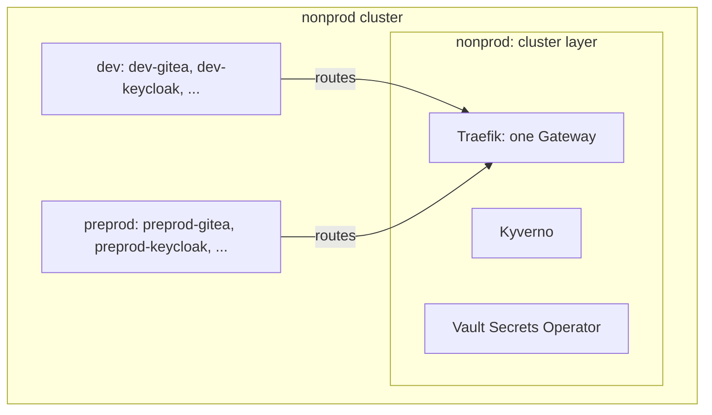

# Shared clusters

Two instances can share a cluster: the two environments of [the platform team's case](20-platform-team.md) run on one non-production cluster. Each keeps its own apps, mount, realm and project; what the cluster holds once for all of them is a third instance's, the cluster layer.

## The cluster layer

A cluster-scoped object has one owner, and an Application that renders it would take it from any other: one instance per cluster runs the apps whose objects are cluster-wide (cert-manager, the ingress controller, the Vault Secrets Operator, CloudNativePG, Kyverno, monitoring), in its core tier. The other instances of the cluster run their apps in their tenant tier and rely on it.

Apps that render cluster-scoped objects named after their release cannot run twice on one cluster either, whatever the instance: the personal Argo CD, Argo Workflows, the Actions Runner Controller, homepage and every operator. Run them on a cluster where they are alone.

## Prefixes

Each instance sets a `namespacePrefix` (`dev-`, `preprod-`), so that its apps' default namespaces are its own: `dev-gitea`, `preprod-gitea`. An entry's own `namespace:` is used as it is, without the prefix. The prefix runs through what is bound to namespaces:

- the instance's project allows its prefixed namespaces only (`dev-*`);
- the hub's spoke entry of the instance carries the same prefix, so that each app's Vault role is bound to its prefixed namespace;
- the layer's Kyverno lists the prefixed namespaces of the apps its built-in exceptions cover, in `exceptionNamespaces` (`rustfs-init-step-limits: [dev-rustfs, preprod-rustfs]`); [security policies](../05-services.md#security-policies) says which two grant host access.

## The shared Gateway

The layer's Traefik runs one Gateway, with a listener per instance's wildcard (`gateway.extraWildcardListeners`), all on one certificate (`gateway.extraDnsNames`). The instances set `names.gateway` to that Gateway, and each route names its instance's listener (`listener: https-dev` in an app's `gateway.routes`). A listener serves only the hosts under its wildcard, so a route on another listener serves nothing, and the render does not show it: `check-example-clusters.sh` does.

## What isolates them

| Between the instances of one cluster | Kept apart by | Not by |
| --- | --- | --- |
| Their secrets | their KV mounts, their jwt mounts, and roles bound to their own namespaces | their cluster's keys, which both jwt mounts trust |
| Their deploys | their projects, each on its own namespaces | |
| Their users | their own Keycloak and realm | |
| Their admins | | the cluster: an admin of it reads both instances' Secrets |

The instances of one cluster share one trust domain. Give an instance a cluster of its own when its data must stay out of another's admins' reach.

## What CI checks

`check-shared-clusters.sh` reads the render of every instance and refuses, on each cluster, two Applications with one namespace and two that render one cluster-scoped object (a kind the API serves cluster-wide, or that a CRD of any instance declares so). It compares clusters by their server string, so give each cluster one ([one server string per cluster](50-remote-clusters.md#one-server-string-per-cluster)).
