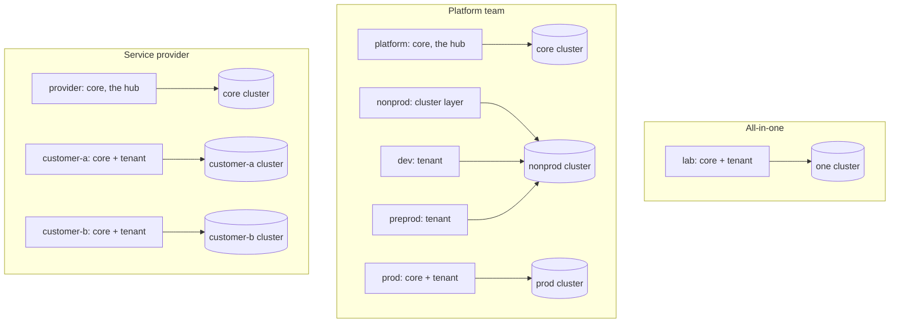

# Topologies

One repository of instances drives one cluster or many. The cases below differ in where each instance runs and which Vault it reads; the charts, the checks and the way Argo CD deploys them are the same.

| Case | Page | Example |
| --- | --- | --- |
| One cluster runs both tiers | [All-in-one](10-all-in-one.md) | [`_example`](../../argo-cd/instances/_example) |
| A platform team: a management cluster, environments on shared and dedicated clusters | [Platform team](20-platform-team.md) | [`examples/platform-team`](../../examples/platform-team) |
| A provider: a management cluster, a cluster per customer | [Service provider](30-service-provider.md) | [`examples/service-provider`](../../examples/service-provider) |

The cases combine three mechanisms, each with a page of its own: [a remote Vault](40-remote-vault.md), [remote clusters](50-remote-clusters.md) and [shared clusters](60-shared-clusters.md).

## Vocabulary

- **Instance**: a folder of `argo-cd/instances/`, with its `instance.yaml`, the apps of each tier (`core.yaml`, `tenant.yaml`) and their values. An instance deploys to one cluster, its `destination.server`.
- **Tier**: the core (the platform's services) or the tenant (the apps people use). Each tier of an instance is an ApplicationSet with an Argo CD project of its own.
- **Cluster layer**: the apps every instance of a cluster relies on: cert-manager, the ingress controller, the Vault Secrets Operator, CloudNativePG, Kyverno, monitoring. Their objects are cluster-wide, and such an object has one owner, so one instance per cluster holds them.
- **Hub**: the instance whose Vault the others read. A **remote instance** names it in `vault.hub` and runs no Vault of its own.

## What every case shares

- **One core Argo CD**, the management instance's (the `ohmlab` chart with its root manager). It deploys every instance of the repository, each to its own cluster.
- **The catalog.** Each instance takes its charts from it, at the version it pins (`catalogs` in `instance.yaml`).
- **One Vault and one ohmlab controller**, the hub's. Every secret is created there from the hub's seeds ([the controller](../08-controller.md)), and read from every cluster.
- **The checks** of `validate-instance.yml`, which an instance repository runs on every change:

| Check | Refuses |
| --- | --- |
| `check-app-projects.sh` | an Application whose project allows no destination of its cluster and namespace, and a root manager that reads its chart from a repository of instances alone |
| `check-shared-clusters.sh` | two Applications on one cluster with one namespace, or one cluster-scoped object |
| `check-vault-access.sh` | an app that cannot log in to its Vault (for a remote instance: the hub's, on its jwt mount) or read its secrets' paths |
| `check-vault-seeds.sh` | a key an app reads that no seed of its Vault holds: the hub's, for a remote app |

The product checks its examples with `check-example-clusters.sh` too, which refuses what would leave an app unusable on its cluster: a route that attaches to no listener of the cluster's Gateway, an https host an app names that no route serves, and a node label or a StorageClass that a managed cluster does not have.

## Where an app runs

A few apps fit either tier: they run wherever their workloads are, on a cluster that acts as the core or as the tenants'. [`_example`](../../argo-cd/instances/_example) lists them in both `core.yaml` and `tenant.yaml`; an instance enables each in exactly one tier, as two entries of one app in one instance would be two Applications of one name.

| App | Where to enable |
| --- | --- |
| `apisix` | wherever it is the ingress controller instead of `traefik` |
| `cert-manager` | wherever certificates are issued |
| `cilium` | wherever the cluster runs the Cilium CNI (not on a managed cluster, which comes with its own) |
| `crowdsec` | wherever the ingress controller whose access logs it reads runs |
| `keycloak` | wherever the identity provider of the users runs: the core of an all-in-one instance, the tenant of a remote one |
| `longhorn` | wherever block storage is needed and the cluster has none |
| `prometheus-stack` | wherever monitoring is collected: every cluster's layer, with Grafana on the core only |
| `teleport` | wherever the access proxy runs |
| `vault` | wherever the secrets backend lives: the hub alone |
