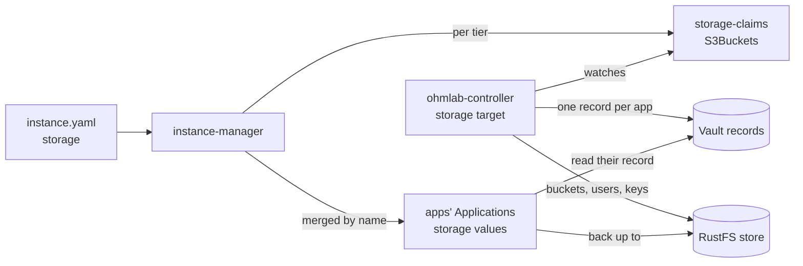

# Object storage

Apps get the object storage they need from claims. The catalog lists each app's claims, such as a bucket for its Postgres backups. An instance names its stores in `instance.yaml`, and the ohmlab controller's storage target makes each bucket, a key confined to it and the app's Vault record ([08-controller.md](08-controller.md#object-storage-s3bucket)). Backups come first: today, the Postgres clusters of the CNPG apps and Vault's snapshots.



## Stores and roles

A store is a RustFS app of the catalog, run as an entry of `core.yaml` and declared in `instance.yaml`'s `storage.stores`. Each role names the store its claims go to: `backups`, and `data` for app data. A role without a store leaves its claims out; while no role names a store, nothing of this renders.

The store runs in the same cluster as the apps it serves, on that cluster's disks. A backup there survives the loss of an app, a database or a volume, not the loss of the cluster: copying the backups to a cloud S3 is not there yet.

The backups store is a RustFS of its own, apart from a RustFS that users reach. It is admin only: no console, no route, no SSO. Only the controller's storage target and the pods of each claim reach its S3 API.

The claims' quotas add up to at most 80 % of the store's size, so that a store never fills before its buckets reach their quotas. CI fails a render above it (`scripts/ci/check-storage-quotas.sh`), and `OhmlabStorageOvercommitted` watches it on the cluster.

## Declaring a store

The example instance carries every piece, commented or disabled ([argo-cd/instances/_example](../argo-cd/instances/_example/)):

1. An entry in `core.yaml`, after the controller: `app: rustfs-backups`, `chart: rustfs`, `releaseName: rustfs`, `namespace: rustfs-backups`.
2. Its values, `values/core/rustfs-backups.yaml`: `store.enabled: true` (below), TLS on, the console off, no route, its own Vault role and record (`rustfs-backups`), no OIDC secret, its network policy, and the labels that put its volumes in Longhorn's `trim` group, out of the daily snapshots.
3. Its root keys, seeded by the `vault-operator` values at `<ohmlab mount>/platforms/<env>/core/<app>`, key `admin` (`accessKey`, `secretKey`). The store reads them, and so does the storage target, which needs no copy in a Secret.
4. The store in `instance.yaml`:

   ```yaml
   storage:
     stores:
       rustfs-backups:
         app: rustfs-backups          # its entry in core.yaml
         namespace: rustfs-backups
         endpoint: https://rustfs-svc.rustfs-backups.svc:9000
         region: us-east-1            # default; set on the store as well
         size: 50Gi
         storageClass: ""             # empty: the app's own
     backups: rustfs-backups
   ```

   From it, the instance-manager sizes the store's volume and sets its region, gives the controller's storage target the store, and gives `vault-operator` the policy and role of that target.

   The store's Application can appear, and sync, a few seconds before its ApplicationSet carries that wiring, and a volume's class and size cannot change once created. With `store.enabled: true`, the store's chart does not render until the wiring arrives (`store.wired`), so its first sync waits for it instead of creating the volume from the chart's defaults.
5. The internal CA in `ohmlab-system`: trust-manager's `targetNamespaces` lists it, since the storage target verifies the store with that CA.
6. The store's namespace in Kyverno's `exceptionNamespaces`, under `rustfs-init-step-limits`, as for any RustFS outside its default namespace ([security policies](05-services.md#security-policies)).

## Claims

The catalog's registry is `storage.claims` in the [instance-manager's values](../argo-cd/apps/instance-manager/values.yaml): per app, each claim's role, quota, wiring and client pods, and whether those pods get an egress policy to the store (`networkPolicy`, below). Today:

| App | Claim | Quota | Wiring |
| --- | --- | --- | --- |
| crowdsec | `pg` | 5Gi | `cnpg` |
| mattermost | `pg` | 4Gi | `cnpg` |
| coder, gitea, harbor, keycloak, mlflow, outline, prometheus-stack, sonarqube, vaultwarden | `pg` | 2Gi | `cnpg` |
| vault-operator | `vault` | 3Gi | `backup-utils` |

`instance.yaml` overrides any field of a claim, and `enabled: false` turns it off:

```yaml
storage:
  claims:
    gitea:
      pg: {quota: 3Gi}
    sonarqube:
      pg: {enabled: false}
```

`storage.claimDefaults` holds what a claim takes unless it sets it: `access: readWrite`, versioning on, noncurrent versions kept 7 days.

For each tier, the instance-manager renders an Application `<instance>-storage-<tier>` of the [storage-claims chart](../argo-cd/apps/storage-claims/). It holds one `S3Bucket` per claim of the tier's enabled apps, in `ohmlab-system`, with `deletionPolicy: Retain`: disabling an app leaves its bucket, its data and its record. A bucket is named `<mount>-<app>-<claim>`, where the mount is the tier's: `ohmlab` for the core tier and the instance's (`names.vaultMount`) for the tenant tier. It holds 3 to 63 characters, and the render fails on a longer one: shorten the instance's name or set `names.vaultMount`. The name leaves the record's env and scope out, so two platforms on one mount and one store would want the same bucket; the older claim keeps it ([08-controller.md](08-controller.md#object-storage-s3bucket)).

An enabled claim gives its app, in the Application's inline values:

- `global.ohmlab.storage.<claim>`: `enabled`, `bucket`, `endpoint`, `region` and `pathStyle`;
- its wiring: `cnpg` turns the CNPG cluster's backups on with the store's endpoint, the bucket and the store's CA, and its monitoring, whose PodMonitor the backup alerts read (the Prometheus Operator's CRDs must exist); `backup-utils` turns the Vault snapshot job on.

The app's key is in its record, `<mount>/platforms/<env>/<scope>/<app>/s3`, one key per claim holding `accessKey`, `secretKey`, `endpoint`, `region`, `pathStyle`, `bucket` and `ca`. The storage target writes it, and the app's VaultStaticSecret reads it.

The claims chart also renders the store's NetworkPolicy, `ohmlab-storage-<tier>` in the store's namespace. It admits each claim's pods and, from the core tier, the storage target, on the S3 port: a store with no policy of its own admits no one else. With `storage.networkPolicies: true`, it renders as well the egress policies from each claim's pods to the store, for an instance whose apps deny egress by default (`networkPolicy.enabled`). On a pod that no other egress policy selects, the claim's would deny the rest of its egress, DNS and the API server included: it is off by default, and CI fails a render where a claim's egress policy would be the only one of its pods (`scripts/ci/check-storage-egress.sh`). A claim whose app keeps its namespace's egress open needs no such policy, its pods reach the store anyway: `networkPolicy: false` on the claim leaves it out. The registry sets it for prometheus-stack, whose chart never denies egress.

## Rolling out

A consumer never comes before its record: the barman-cloud plugin's pre-reconcile hook blocks a Postgres cluster whose backup Secret is empty. Three steps, each checked before the next:

1. The records. The store, its seed, `storage` in `instance.yaml` with `wireConsumers: false`, and the controller's storage target with `targets.storage.observeOnly: true` in the `ohmlab-controller` values. The target needs egress to Vault, like the vault target. Each `S3Bucket` reports `Drifted` (reason `ObserveOnly`), and `ohmlab_planned_changes` counts what a live run would do.
2. Live. `observeOnly: false`: each `S3Bucket` goes `Ready`, and its bucket, user and record exist.
3. The consumers. `wireConsumers: true`, and any `cnpg.backups` of the apps' own values removed: the claims set them now. Each Postgres cluster takes a first base backup at once.

## Backups

- **Postgres.** Each CNPG app backs up with the barman-cloud plugin: WAL continuously, and a base backup every day, five minutes apart from 20:00 UTC (crowdsec 20:00, gitea 20:05, keycloak 20:10, mattermost 20:15, prometheus-stack 20:20, outline 20:25, harbor 20:30, sonarqube 20:35, mlflow 20:40, vaultwarden 20:45, coder 20:50). They are kept 30 days, gzip-compressed. The ObjectStore syncs before the cluster.
- **Vault.** A raft snapshot every day at 22:00 UTC (CronJob `backup-vault-snapshot` in vault-operator's namespace), kept 30 days. The job logs in as the ServiceAccount `vault-backup`, whose role reads the snapshot and nothing else, with a projected token, and verifies the TLS of Vault and of the store.

A noncurrent object version expires after the claim's `noncurrentDays`. RustFS, as S3, rounds a due time up to the next midnight UTC, so a version goes between N and N+1 days.

## Alerts

With the storage target on:

| Alert | Fires when | Look at |
| --- | --- | --- |
| `OhmlabPostgresBackupStale` | a cluster's newest base backup is more than 26 hours old, for 1h | its ObjectStore's status, the `plugin-barman-cloud` sidecar of its pods |
| `OhmlabWALArchivingFailing` | a cluster's last WAL archive attempt failed after its last success, for 15m | the same |
| `OhmlabVaultSnapshotStale` | the snapshot job has not succeeded in 26 hours (counted from its creation if it never did), for 30m | the logs of its last Job |

The store's own alerts (`OhmlabStoreFilling`, `OhmlabStoreFull`, `OhmlabBucketNearQuota`, `OhmlabStorageOvercommitted`) are in [08-controller.md](08-controller.md#metrics-and-alerts).

## Restoring

Neither runbook has been drilled on a cluster yet; CI renders the Postgres one (`scripts/ci/test-cnpg-backups.sh`).

**Postgres.** A cluster restores into a new cluster of the same name, from its claim's ObjectStore: keep the claim on. The old cluster must be gone first, lost with its volumes or deleted by hand for a point-in-time restore (deleting a CNPG Cluster deletes its volumes). Then, in the app's values, point the cluster at the backups and sync:

```yaml
cnpg:
  mode: recovery
  recovery:
    method: plugin
    clusterName: <app>-pg-cluster                # the server name of the backups
    pluginConfiguration:
      name: barman-cloud.cloudnative-pg.io
      parameters:
        barmanObjectName: <app>-pg-cluster-backups   # the claim's ObjectStore
    objectStore:
      create: false                              # use that ObjectStore as it is
    secret:
      create: false                              # and its credentials
    pitrTarget:
      time: ""                                   # RFC 3339; empty: replay every WAL
  cluster:
    plugins:
    - name: barman-cloud.cloudnative-pg.io
      parameters:
        serverName: <app>-pg-cluster-2           # no archive in the bucket under it yet
```

The new cluster starts from the newest base backup before the target and replays the WAL after it. It archives under a server name of its own, so its WAL never mixes with the history it came from. Keep both in the values: the bootstrap runs only when the cluster is created, and a later restore takes the last server name as `clusterName`.

**Vault.** A snapshot opens only with the unseal keys of the Vault that took it: keep them outside the cluster, never in the store. Take the newest snapshot from the `vault` claim's bucket with its record's key, then, on that Vault with a root token, `vault operator raft snapshot restore -force <snapshot>`, and unseal with those keys.

## Not there yet

- Stores other than an in-cluster RustFS: a cloud S3 as a store, and a copy of a store to a cloud S3.
- Claims of apps on an instance that reads another instance's Vault (`vault.hub`): the render refuses them.
- Backups of Longhorn volumes, of etcd, and of apps' data other than Postgres.
